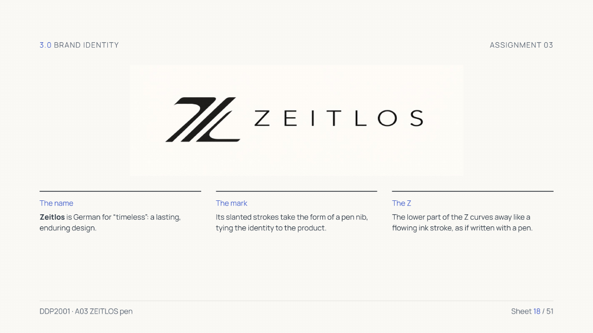
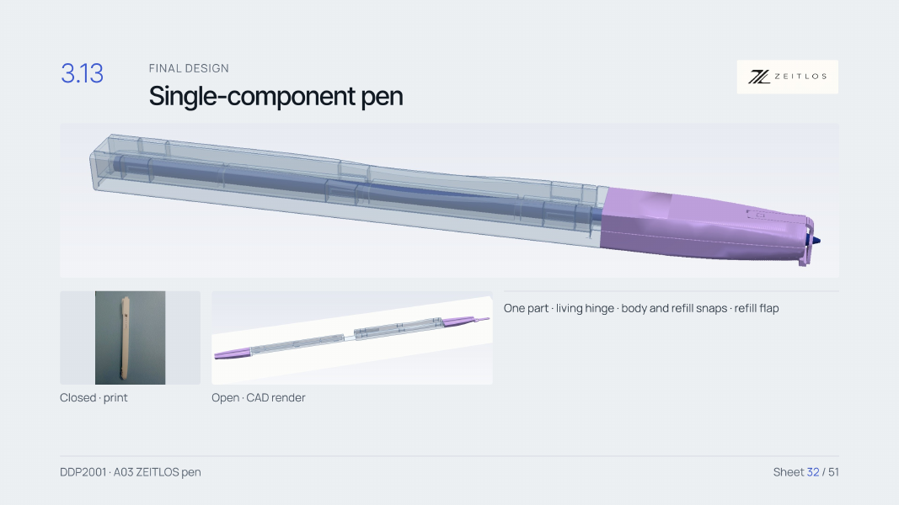
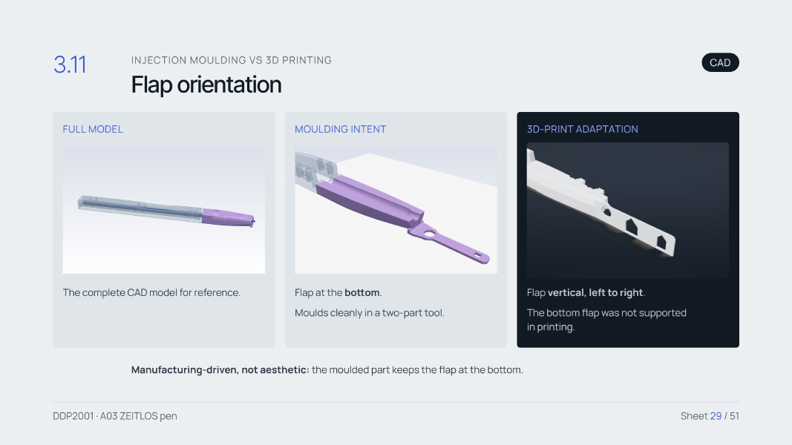

# ZEITLOS: single-component pen

**ZEITLOS** (German for "timeless") is a pen body designed to be injection moulded as **one part in a two-part mould**. Two halves, a rear living hinge, body and refill snaps, a pocket clip and a protective flap over the nib all come out of a single shot. The 3D-printed version prints in one piece without supports.

Assignment 03, *Injection-mouldable pen*, DDP2001 Industrial Design, Semester 3. Simran P. Varma, IIT Delhi.

## The design

- **One hinged part.** Half A (wide) and half B (narrow) are moulded open, joined at the rear by a living hinge. Half B folds onto half A and snaps shut along both edges.
- **Refill held on axis.** Ring snaps grip the refill. The refill seats on a cone near the nose, and the nib exits through the nozzle face.
- **Side flap over the nib.** A thin flap hinged to the nose wraps across the nozzle and locks onto protrusions on the left side of the pen.
  - **Writing:** the lock hole sits on the rear protrusion. The flap lies flat across the face, and the nib passes through its round hole.
  - **Closed:** the lock hole sits on the front protrusion. The spare flap length bows into an arch that covers the nib.
- **Brand mark.** The slanted strokes of the Z take the form of a pen nib. The lower part curves away like an ink stroke.

## Repository layout

| Folder | Contents |
| --- | --- |
| [`cad/v20-final/`](cad/v20-final) | Final model: one-piece print STEP, plus a colour-coded assembled STEP (clear body, purple tip and flap, ink-blue refill) |
| [`cad/earlier-iterations/`](cad/earlier-iterations) | v10 (top flap), v11 (first side flap), clip-and-cap version, first one-piece model |
| [`cad/original-input/`](cad/original-input) | The original three-part model: two halves and a hinge |
| [`print/`](print) | Sliced Bambu Lab H2D print file (`.gcode.3mf`) |
| [`docs/`](docs) | [Design history](docs/design-history.md), [3D printing guide](docs/printing.md), [injection moulding spec](docs/moulding-spec.md), process sheets (PDF and PNG), reference images |
| [`media/`](media) | ZEITLOS reel (video) and hand sketches |

## Key dimensions (v20, mm)

| Feature | Size |
| --- | --- |
| Closed pen | 141.0 long x 10.8 wide x 8.0 high (13.4 wide with clip) |
| Wall thickness | 2.2 |
| One-piece open layout | 318.4 x 14 x 8.3 |
| Refill (reference) | 139.56 overall; tube dia 3.2 x 132.8; tip dia 2.31 |
| Refill bore / nozzle bore | dia 3.50 / dia 2.60 (0.15 radial clearance each) |
| Nib past the nozzle face | 4.4-5.0 |
| Flap (print) | 0.45 thick, 5.2 tall along the side |
| Lock protrusions | stem 2.40 x 2.90, locking head 3.60 long; 5.5 and 15.0 behind the nozzle face |

## Making it

- **3D print:** one piece, no supports. PETG on a Bambu Lab H2D/H2S, with thin-wall detection on. See [docs/printing.md](docs/printing.md).
- **Injection moulding:** PP homopolymer (living-hinge grade), single-cavity two-plate mould, about 8.5 g. See [docs/moulding-spec.md](docs/moulding-spec.md).

The printed and moulded versions differ only where the process demands it. The print stands the flap upright so it needs no support. The mould lays the flap flat at the bottom so it fills cleanly in a two-part tool.

## Opening the files

- **STEP files** open in Fusion 360, SolidWorks, Onshape, FreeCAD and most CAD tools. The assembled STEP keeps its colours and transparency.
- **The `.gcode.3mf`** opens in Bambu Studio.
- STL is not stored. Export it from the STEP file, or import the STEP straight into your slicer.
